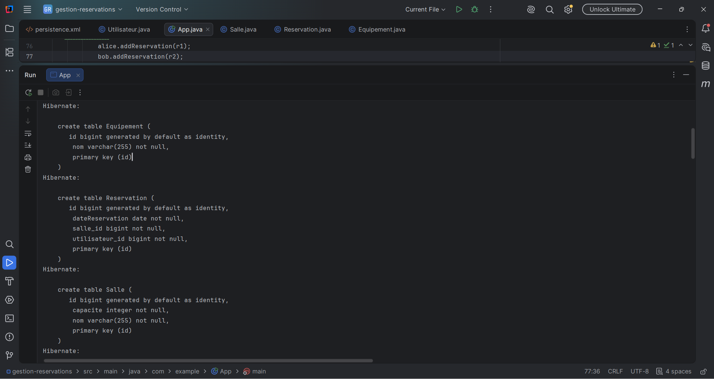
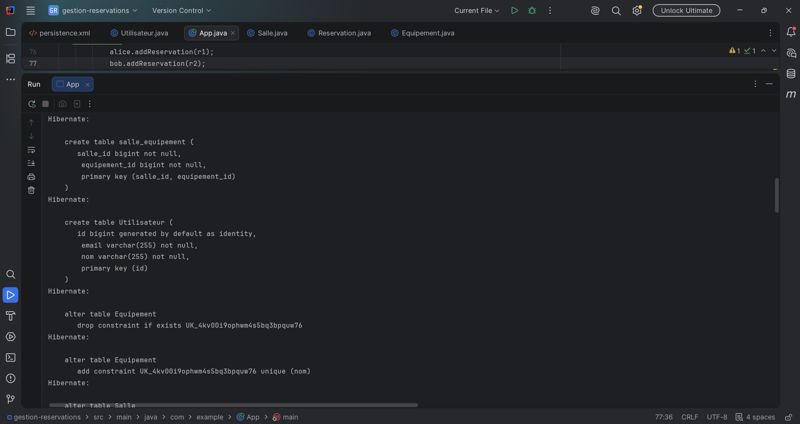
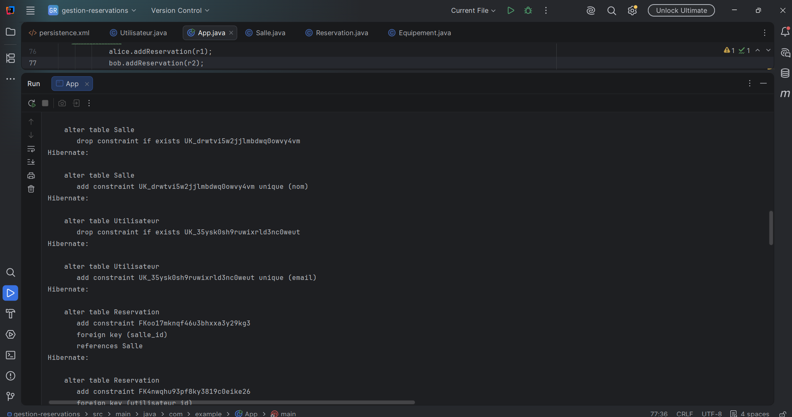
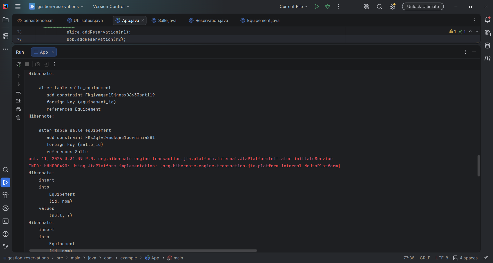
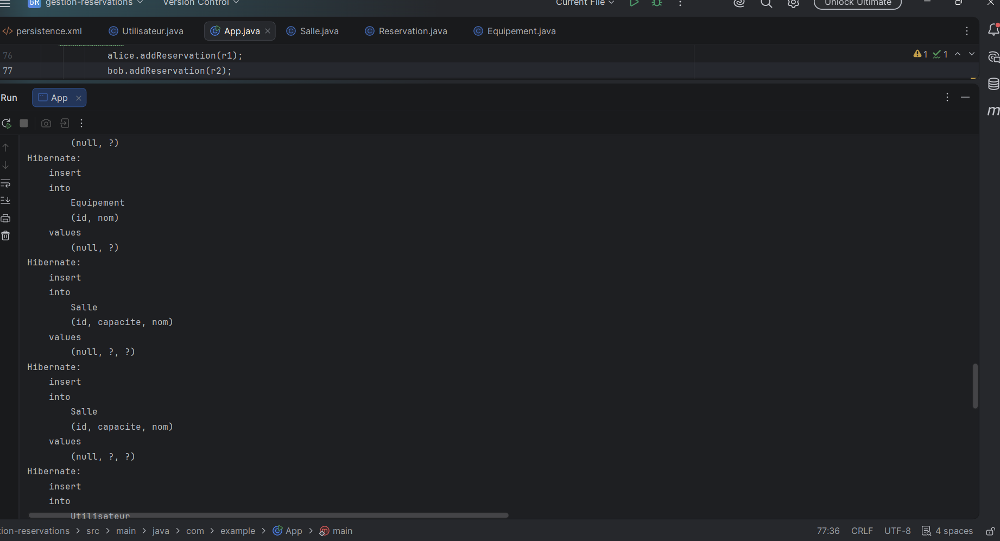
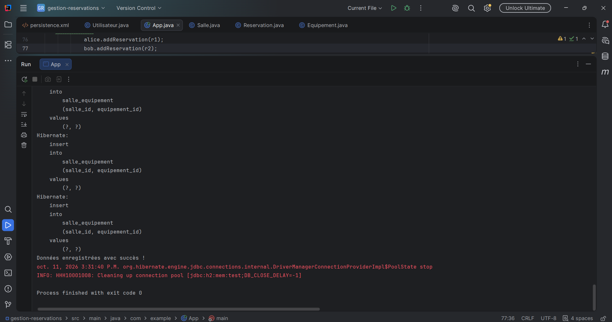
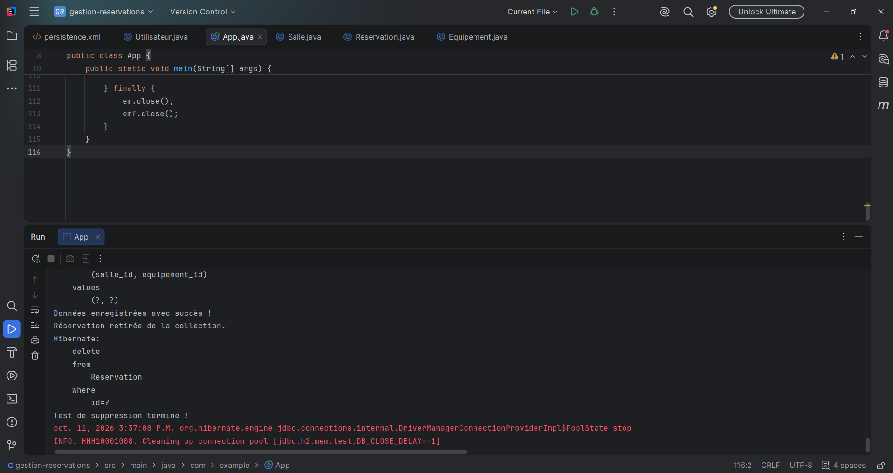
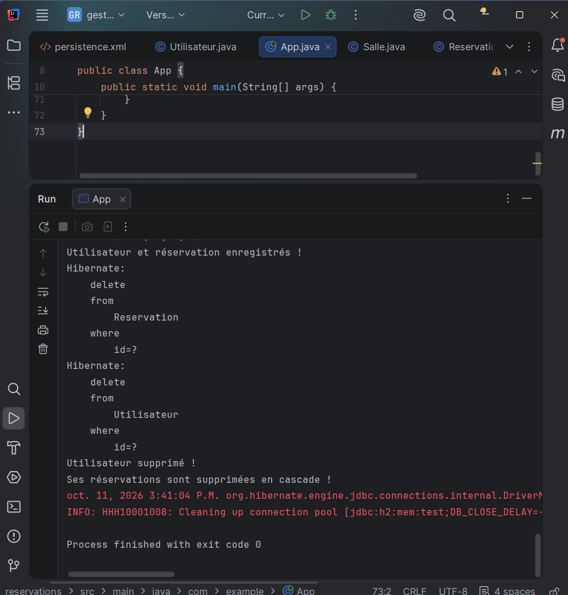
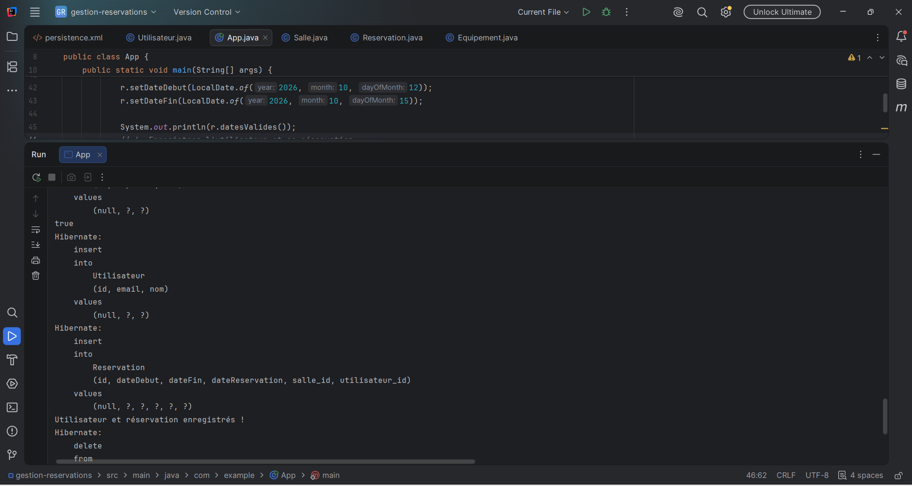

# TP_3 : Gestion des réservations (JPA / Hibernate)

## Description
Application JEE utilisant **JPA** et **Hibernate** pour gérer des réservations de salles.
Base de données : **H2**. Projet géré avec **Maven**.

## Structure du dépôt
- [gestion-reservations](./gestion-reservations) : code source
- [lab3](./lab3) : captures d'écran

## Preuves d'exécution

### 1. Capture 1

### 2. Capture 2

### 3. Capture 3

### 4. Capture 4

### 5. Capture 5

### 6. Capture 6

### 7. Capture 7

### 8. Capture 8

### 9. Capture 9

